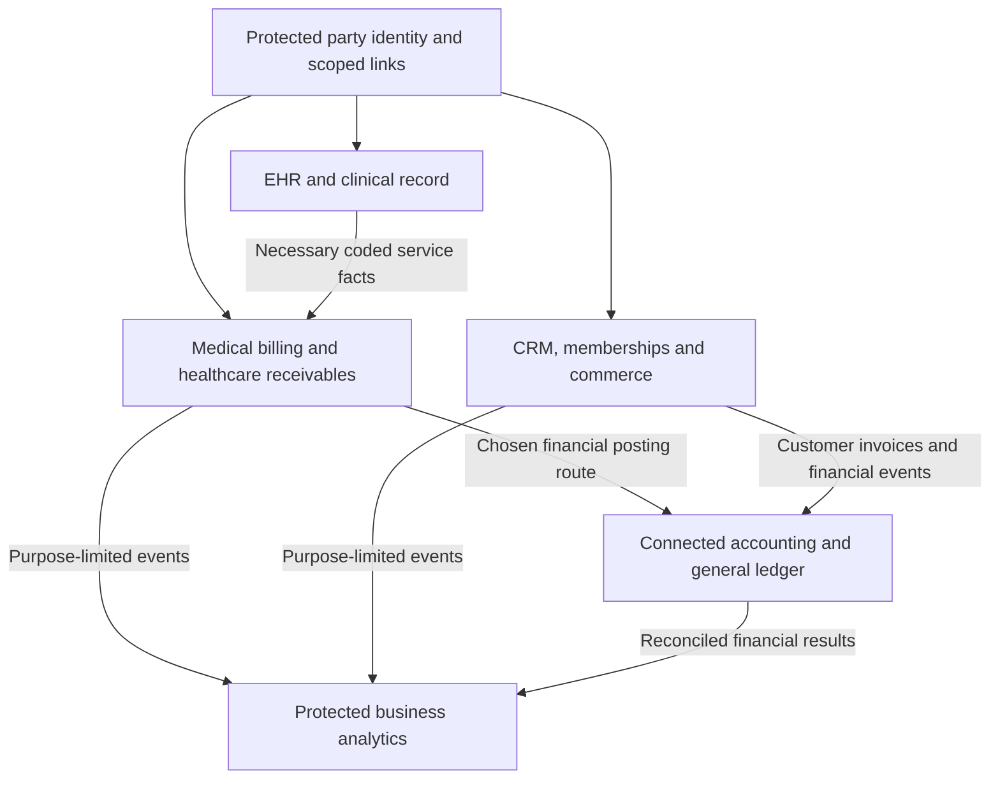

# Synthesis: Customer To Books — Brainstorm

Status: brainstorm
Kind: architecture
Summary: role-aware identity, explicit obligation ownership, and purpose-bound views let the practice operate across medical care, memberships, and sales while keeping chart authority and financial truth separate.
Topics: openpractice-customer-financial-separation, financial-control, registration, reporting, synthesis
Repository context: openPractice — relationships among identity, billing, connected commerce/accounting, and business reporting
Captured: 2026-11-14

## Possible feats

- **Customer-to-books trace** — explain a customer's obligation, payment, recognition and settlement across authoritative systems.
- **Protected accounting handoff** — deliver necessary named financial records with explicit field and recipient contracts.
- **Whole-practice business view** — compare medical, membership and retail performance without double counting or importing the chart.

## Members and their joints

Atomic members: [Customer Identity And Patient Roles](openpractice-customer-financial-separation-identity.md),
[Financial Routing](openpractice-customer-financial-separation-financial-routing.md),
and [Purpose-Bound Business Views](openpractice-customer-financial-separation-business-views.md).

Connections represent defined projections and contracts. Access to one node
does not grant access to every linked record.

### Identity connects the relationship, not every field

The party register correlates a person acting as patient, customer or member.
Payer and representative relationships determine which obligations and notices
that person may see. Customer creation in accounting carries a scoped projection
and a reversible, attributable link. It does not copy the EHR patient record.

### Financial routes converge at books and settlement

An insurance claim derives from the medical obligation. A membership renewal
derives from the subscription agreement. A retail invoice derives from the order.
Each has one authoritative obligation identifier, including when accounting
represents that same receivable. A payment can allocate across several compatible
obligations while its bank settlement is reconciled once.

Medical and commercial detail can appear in a consolidated authorized customer
view. That view preserves legal-entity, merchant and relationship boundaries;
it does not create another ledger, another claim or another debt. Recurring
subscriptions use ordinary subscription billing; they do not require invented
visits or a new Thread type in the existing closed enumeration.

### Useful business detail remains protected where applicable

The accounting projection retains customer identity and necessary financial
facts. The clinic's chart stays in the EHR. A named medical membership invoice
remains protected even though it contains no clinical note. Accounting and
medical billing can have different job scopes inside the same protected estate.

Analytics joins selected facts with definitions for billed, collected,
recognized and net revenue. A campaign consumes a separately authorized
communication intent; computing an audience is not authority to contact it.

### Failures become bounded work

An ambiguous identity match is held for identity adjudication. An unresolved
membership entitlement is financial review work. A rejected accounting posting
keeps its original source identity and reconciliation status. A timed-out
external payment remains indeterminate until authoritative reconciliation.
None of these failures licenses a duplicate charge or broader clinical access.

Record a permitted intent and attributable outcome without logging customer
payloads into diagnostic output. On contract end or revocation, stop future
access and delivery while preserving applicable retention obligations and holds.
The existing [reimbursement lifecycle proposal](../../openspec/changes/add-reimbursement-retention-control/proposal.md)
remains separate governance work; this packet does not alter its approval state.

## Emergent behavior

The owner can ask how membership tenure, purchases and communications relate
to revenue. The accountant can reconcile named invoices and settlements. The
biller can work claims and patient responsibility. The clinician can retain
exclusive authority over clinical facts. Correlation does not imply identical
views or permissions.

## Tensions to hold

- More detailed customer accounting increases protected-data exposure and connector responsibility.
- Separate obligation owners require deterministic posting and consolidation rules.
- A membership can span medical and nonmedical benefits, with rules that cannot be inferred from its name.
- Existing small-practice surfaces and shipped role recipes must absorb the boundary without enterprise policy-authoring screens.

## Recombination opportunities

Use the current party register, service catalog, Roster, Money Lines, communication
decisions, versioned metrics and accounting export artifacts. Preserve FD-3's
post-time immutability and batch freeze and FD-5's financial authority. General
accounting stays external. Concrete membership and retail delivery is sequenced
separately; architectural support does not silently enlarge beta acceptance.

## Open questions

- Which connector and posting route exercise the first customer-to-books trace?
- Which membership/retail scenarios are required for the first release?
- What is the minimum reviewed recipient/field profile for each external system?

## Relationships

The [Overview](openpractice-customer-financial-separation-overview.md) records
the existing-spec review, decision scope, and OpenSpec handoff.
